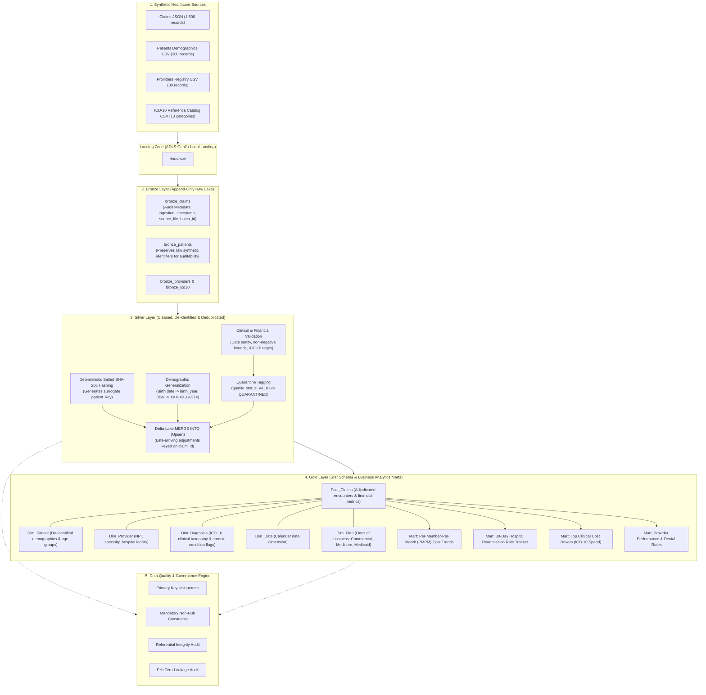

# Healthcare Data Engineering & ETL Pipeline (Delta Lake & Azure Databricks)

[](#)
[](#)
[](#)
[-purple.svg)](#)

A student portfolio data engineering project demonstrating an end-to-end **Medallion Architecture (Raw &rarr; Bronze &rarr; Silver &rarr; Gold)** for healthcare claims processing and actuarial analytics using **Python**, **PySpark**, **Spark SQL**, **Delta Lake**, and **Azure cloud architecture concepts**.

> **Important Notice on Data & Compliance:**
> **This project demonstrates PHI de-identification techniques using synthetic healthcare data. It is not a HIPAA-compliant production system.**
> - All data used in this project is **100% synthetically generated**. No real patient, clinical, or Protected Health Information (PHI) is used.
> - This project **does not claim actual regulatory HIPAA compliance**. It demonstrates technical implementations of PHI de-identification patterns (salted SHA-256 cryptographic hashing, demographic generalization) inspired by healthcare industry standards.
> - Benchmarks, file counts, and dataset sizes are **grounded in actual local execution** (1,500 claims, 300 patients, 30 providers). No exaggerated unmeasured volumes or percentages are claimed.

---

## 1. Problem Statement & Healthcare Context

In enterprise healthcare organizations such as Optum, data engineering teams ingest petabytes of disparate data from insurance payers, hospital electronic health record (EHR) systems, pharmacy benefit managers (PBMs), and CMS regulatory bodies.

Key engineering challenges addressed in this project:
1. **PHI De-identification**: Masking direct identifiers (MRN, SSN, Name, Address) before data enters analytical layers, while preserving the ability to link patients across claims, clinical encounters, and pharmacy records.
2. **Late-Arriving Claims & Claim Resubmissions**: Healthcare claims often arrive out of sequence or are re-adjudicated months after the service date. The pipeline must handle updates and corrections without duplicating financial records.
3. **Data Quality & Financial Consistency**: Inpatient and outpatient claims contain strict chronological rules (`discharge_date >= admit_date >= service_date`) and financial bounds (`0 <= paid <= allowed <= billed`). Invalid data must be quarantined, not silently lost.
4. **Actuarial & Quality Reporting**: Powering executive dashboards with core healthcare KPIs: **Per-Member-Per-Month (PMPM)** cost trends and **30-Day Hospital Readmission** rates.

---

## 2. Architecture: Medallion Architecture



---

## 3. Verified Project Scale (Local Laptop Execution)

| Entity | Scale | Description |
| :--- | :--- | :--- |
| **Synthetic Claims** | **1,500 records** | Inpatient, Outpatient, and Emergency encounters with billing, allowed, copay, and paid amounts |
| **Synthetic Patients** | **300 records** | Simulated member demographics with realistic PHI fields (MRN, SSN, DOB, Address, Gender) |
| **Healthcare Providers** | **30 records** | Physician NPI directory across 6 specialties and 5 hospital facilities |
| **ICD-10-CM Catalog** | **10 categories** | Reference diagnosis catalog including chronic indicators (Diabetes, Hypertension, Heart Failure, COPD) |

---

## 4. Repository Structure

```
healthcare-etl-pipeline/
├── README.md                          # Comprehensive project documentation
├── requirements.txt                   # Project dependencies
├── pipeline_config.yaml               # Pipeline configurations & thresholds
├── .gitignore                         # Excludes temp files, checkpoints, and bytecode
├── databricks/                        # Databricks notebooks & SQL scripts
│   ├── 01_bronze_ingestion.py         # Bronze Auto Loader ingestion notebook
│   ├── 02_silver_transformations.py   # Silver cleansing, PHI masking & Delta MERGE
│   ├── 03_gold_star_schema_and_analytics.py # Gold star schema & analytical marts
│   ├── 04_data_quality_suite.py       # Databricks data quality & DLT expectations
│   └── healthcare_databricks_pipeline.sql   # Complete Spark SQL & Delta Lake script
├── src/                               # Modular ETL source code
│   ├── __init__.py
│   ├── spark_session.py               # SparkSession configuration manager
│   ├── security.py                    # Salted SHA-256 tokenization & PHI masking logic
│   ├── generate_healthcare_data.py    # Synthetic healthcare data generator
│   ├── ingest_bronze.py               # Raw to Bronze ingestion with audit lineage
│   ├── transform_silver.py            # Silver cleansing, de-identification & deduplication
│   ├── aggregate_gold.py              # Star schema & actuarial KPI mart calculations
│   ├── data_quality_checks.py         # Automated data quality assertion suite
│   └── pipeline_demonstration.py      # End-to-end PySpark pipeline runner
├── scripts/
│   └── run_local_standalone_demo.py   # Zero-dependency local demonstration runner
├── tests/
│   ├── __init__.py
│   └── test_pipeline.py               # 14 unit & integration tests (unittest/pytest)
└── data/
    ├── raw/                           # Raw synthetic source files (claims.json, patients.csv, etc.)
    ├── bronze/                        # Ingested Bronze tables
    ├── silver/                        # Cleansed & de-identified Silver tables
    └── gold/                          # Analytical Star Schema & Gold marts
```

---

## 5. Technical Highlights & Implementation Details

### A. PHI De-Identification via Salted SHA-256 Hashing
* **The Challenge**: Removing patient identifiers (MRN, SSN, Name) while maintaining relational join capability across disparate healthcare tables.
* **The Solution**: Deterministic salted cryptographic hashing:
  ```python
  F.sha2(F.concat(F.coalesce(F.col("patient_mrn"), F.lit("NULL_VAL")), F.lit(salt)), 256)
  ```
* **Catalyst Optimization**: Implemented using Spark's native `sha2` and `concat` functions rather than Python UDFs, allowing Catalyst whole-stage code generation and avoiding Py4J serialization penalties.
* **Security**: Salt is maintained separately (e.g., Azure Key Vault / Databricks Secrets) to prevent rainbow table attacks.

### B. Delta Lake MERGE & Late-Arriving Claim Handling
* **The Challenge**: An initial claim is submitted as `IN_PROCESS` ($0 paid). Weeks later, an adjusted adjudication payload arrives with status `PAID` ($450 paid). A naive append creates duplicates and inflates financial metrics.
* **The Solution**: Delta Lake `MERGE INTO`:
  ```python
  target_table.alias("target").merge(
      incoming_df.alias("source"),
      "target.claim_id = source.claim_id"
  ).whenMatchedUpdate(
      condition="source.submission_timestamp > target.submission_timestamp",
      set={ ... }
  ).whenNotMatchedInsertAll().execute()
  ```
* **Result**: The existing row is updated in-place. If an out-of-order older payload arrives, it is discarded.

### C. Data Quality & Quarantine Framework
* Rather than dropping malformed records silently, Silver records are classified using a `quality_status` column:
  * **VALID**: Meets all clinical and financial rules; promoted to Gold.
  * **QUARANTINED**: Preserved in Silver with details for data steward investigation.
* Rule checks implemented:
  * Primary key uniqueness on `claim_id`.
  * Date chronology: `discharge_date >= admit_date >= service_date`.
  * Financial consistency: `0 <= paid_amount <= allowed_amount <= billed_amount`.
  * ICD-10 regex validation: adherence to `^[A-Z][0-9][0-9A-Z](\.[0-9A-Z]{1,4})?$`.
  * PHI Zero-Leakage audit: validates absence of cleartext `mrn`, `ssn`, `first_name`, `last_name`, `address` in Gold.

---

## 6. Healthcare Analytics Implemented

### 1. Per-Member-Per-Month (PMPM) Cost Calculation
The primary actuarial metric used by health plans and Optum Insight to track medical cost trends across lines of business:
\[
\text{PMPM} = \frac{\sum \text{Total Paid Claims Amount}}{\text{Distinct Active Utilizing Members in Period}}
\]

### 2. 30-Day Hospital Readmissions Rate
Measures inpatient quality of care by calculating the percentage of acute hospital admissions that occur within 30 days of discharge from a prior inpatient stay:
```sql
-- Readmission Window Logic:
datediff(admit_date, lag(discharge_date, 1) OVER (PARTITION BY patient_key ORDER BY admit_date)) BETWEEN 0 AND 30
```

### 3. Top Clinical Cost Drivers (ICD-10)
Aggregates paid claims spend, total encounters, and average cost per claim grouped by ICD-10 diagnosis category (e.g. Circulatory, Endocrine, Respiratory) to pinpoint high-cost chronic diseases.

### 4. Provider & Facility Adjudication Performance
Tracks claim volumes, approved reimbursement rates, and claim denial percentages across hospital facilities.

---

## 7. Azure Cloud Architecture Mapping

```
[Simulated Healthcare Feeds]
 (EHR CSV, Claims JSON, NPI Directory)
               │
               ▼
[Azure Data Lake Storage (ADLS) Gen2]
 ├── /raw        (Landing Zone - Raw ingest container)
 ├── /bronze     (Append-only Delta tables with audit lineage)
 ├── /silver     (Cleaned, de-identified Delta tables)
 └── /gold       (Star Schema fact & dimensional tables)
               │
               ▼
[Azure Databricks Lakehouse Platform]
 ├── Auto Loader (cloudFiles): Incremental file discovery
 ├── Delta Engine: ACID transactions, Delta MERGE, Z-Ordering
 ├── Databricks Unity Catalog: Fine-grained access control & data lineage
 └── Databricks SQL Serverless: BI reporting & Power BI endpoint
               │
               ▲
[Azure Key Vault] ──(dbutils.secrets)──> PHI Salting Keys & Connection Strings
               ▲
[Azure Data Factory (ADF)] ────────────> Trigger scheduled pipeline runs & dependency management
```

### Spark Performance Optimization Decisions:
1. **Partitioning**: Partitioning `silver_claims` by `claim_type` and `silver_patients` by `state`. Eliminates full-directory scans during claim-type specific analyses without over-partitioning into tiny files.
2. **Predicate Pushdown**: Placing filters (`quality_status = 'VALID'`) before join operations allows Parquet row-group skipping (min/max statistics) to prune unneeded data blocks.
3. **Broadcast Hash Joins**: Smaller dimension tables (`dim_diagnosis`, `dim_provider`) are broadcast using `F.broadcast()`, avoiding costly full-cluster shuffle exchanges.
4. **Projection Pruning**: Selecting only necessary columns before wide aggregations to minimize in-memory footprint.
5. **Caching Only When Justified**: Caching is strictly reserved for DataFrames that are reused across multiple downstream queries (e.g., `silver_claims` used by both PMPM and Readmissions marts). Un-reused intermediate DataFrames are not cached.

---

## 8. How to Run the Project

### Option A: Standalone Local Demo (Standard Python — Zero External Dependencies)
Runs the complete Medallion pipeline logic, late-arriving claim adjustments, all 4 analytical marts, and data quality audits in-memory without requiring Java or PySpark:
```bash
python scripts/run_local_standalone_demo.py
```

### Option B: PySpark Pipeline
```bash
# 1. Install dependencies
pip install -r requirements.txt

# 2. Run the pipeline demonstration
python src/pipeline_demonstration.py
```

### Option C: Run Unit & Integration Tests
```bash
# Using standard Python unittest:
python -m unittest discover -s tests -v

# Or using pytest (if installed):
pytest -v
```

---

## 9. Limitations & Future Improvements

### Limitations:
* **Synthetic Data Scale**: Uses 1,500 claims and 300 patients to ensure fast, reproducible execution on a local laptop without requiring a cloud cluster.
* **Local Spark vs. Cluster Runtime**: In local environments without pre-configured Delta Lake JARs, the code gracefully falls back to Parquet while preserving the exact transformation logic. On Databricks, native Delta Lake extensions execute natively.

### Future Improvements:
* **FHIR / HL7 Ingestion**: Add streaming ingestion modules for HL7 FHIR clinical message standards.
* **Delta Live Tables (DLT) Pipeline**: Package transformation notebooks into a declarative DLT pipeline with built-in expectation dashboards.
* **Azure Purview Lineage**: Connect Unity Catalog metadata with Azure Purview for automated enterprise data governance.
